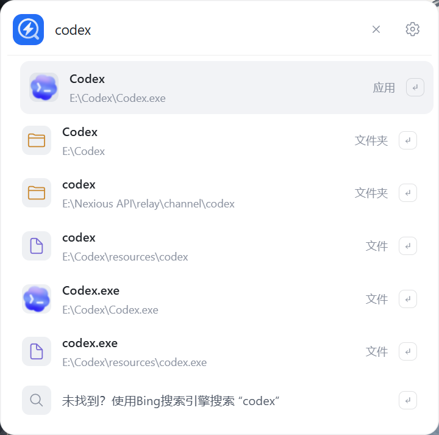
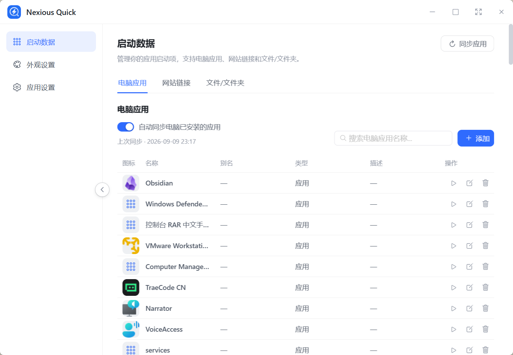
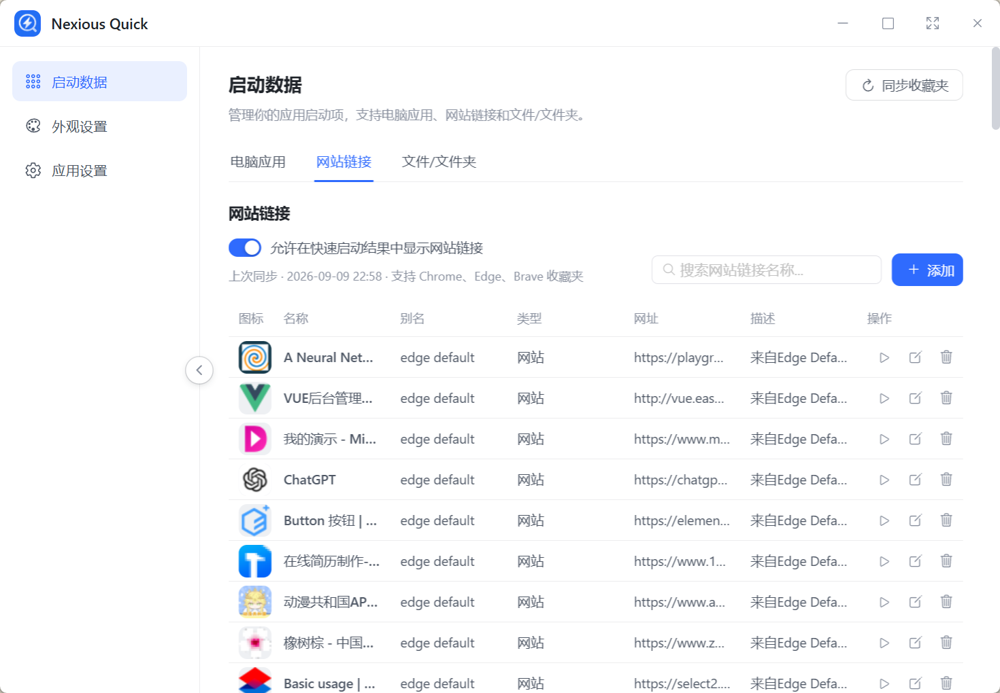
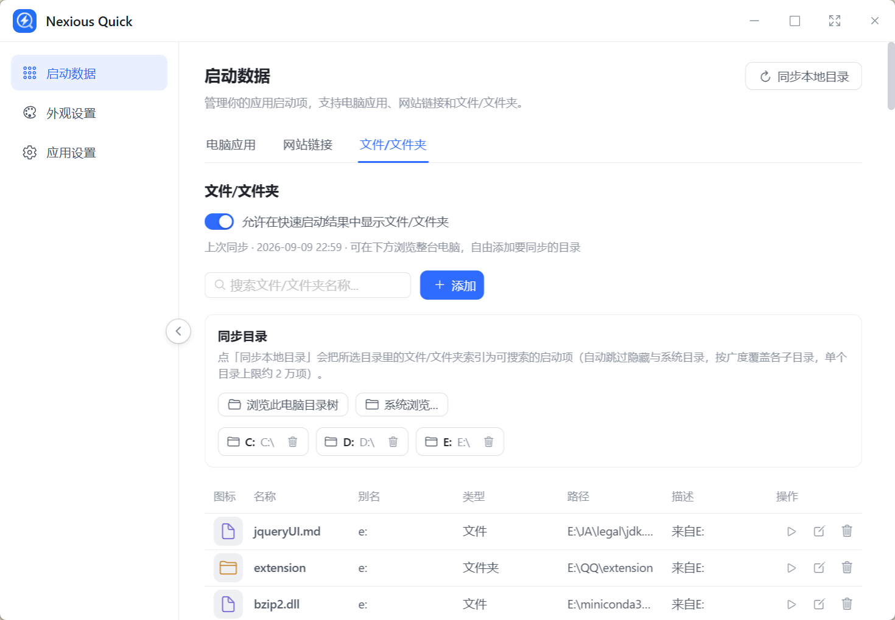
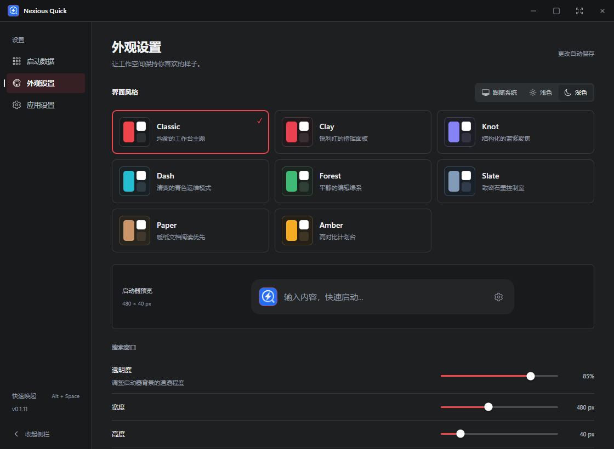
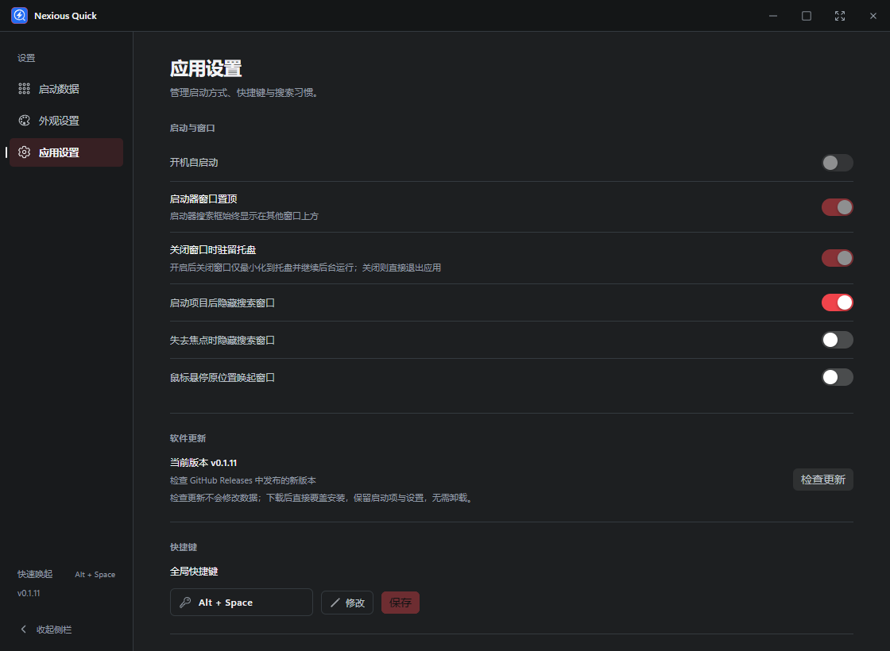

# Nexious Quick

Nexious Quick 是一款 Windows 桌面快速启动工具。按下全局快捷键，输入关键词即可快速启动电脑应用、网站链接、文件与文件夹，并支持对已安装应用、浏览器收藏夹和本地目录进行自动同步与检索。

## 应用截图

### 快速启动




### 启动数据





### 外观设置




### 应用设置


## 功能特性

- **全局唤起**：自定义快捷键随时显示 / 隐藏搜索窗口，启动器可置顶显示
- **一键启动**：搜索应用、网站、文件与文件夹；无结果时可快速跳转搜索引擎
- **应用同步**：自动扫描开始菜单、桌面快捷方式、Microsoft Store 应用与系统注册的应用，同步时保留启动参数、补全图标，并支持“运行 / 控制面板 / 资源管理器 / steam:// 协议”等特殊启动方式
- **收藏夹同步**：支持 Chrome、Edge、Brave 浏览器收藏夹同步，自动补全网站图标
- **本地目录同步**：以资源管理器方式浏览整台电脑并添加目录，把文件 / 文件夹索引为可搜索的启动项
- **数据管理**：集中管理启动数据，支持别名、描述、图标与重复项检测（添加重复项会给出提示）
- **个性化外观**：深浅色主题、多套主题色、透明度、搜索框圆角、启动器图标与提示文字均可自定义
- **窗口与托盘**：支持启动器置顶、失去焦点自动隐藏、鼠标悬停唤起、关闭窗口驻留系统托盘
- **常用设置**：开机自启动、搜索框行为、默认搜索引擎与全局快捷键配置
- **检查更新**：在应用设置中一键检查 GitHub Releases 发布的新版本并跳转下载

## 自动同步说明

- 应用、Chrome / Edge / Brave 收藏夹与已选本地目录在启动后自动同步，每轮完成后间隔 15 秒再次检查；隐藏窗口或驻留托盘时仍然运行。应用同步可在「电脑应用」中关闭，网站和文件的显示开关只控制搜索结果。
- 同步同时处理新增、修改和删除：卸载应用、删除收藏、重命名或删除文件后，对应的自动导入条目会更新或移除，已打开的搜索结果也会刷新。多个浏览器或重叠目录仍包含同一条目时会保留。
- 手动添加的条目保留；旧版本能识别的自动导入条目会迁移为同步数据。扫描失败会保留原索引并在后续自动重试。目录暂不可访问或达到原有索引限制（每个目录约 2 万项、24 层）时，未扫描部分受到保护，手动同步会显示具体提示。
- 同步是从系统、浏览器和目录更新启动索引，不会删除原始软件、收藏或文件。手动同步会显示实际新增、更新、移除数量。

## 升级与数据保留

应用内「检查更新」只查询 GitHub Releases 的版本，不修改启动项、设置或历史记录。下载新版安装包后直接覆盖安装，无需先卸载。请使用与原安装相同的安装方式（EXE 或 MSI）。

数据始终存放于 `%APPDATA%\com.nexious.quick\nexious.db`，不随版本号变化，也不打包进安装程序。从旧版首次升级到 v0.1.9 时，会在迁移前自动生成 `backups\nexious-before-0.1.9.db`，保留迁移前的完整数据库。迁移保留已有条目、别名、自定义描述/图标、启用状态、设置和搜索历史；后续自动同步仍会正常处理源数据的新增、修改和删除。

## 技术栈

- Tauri 2 + Rust（SQLite 本地存储）
- Vue 3 + TypeScript + Vite
- Naive UI + Ionicons
- pnpm 包管理

## 运行

```bash
pnpm install
pnpm tauri dev
```

构建安装包：

```bash
pnpm tauri build
```
